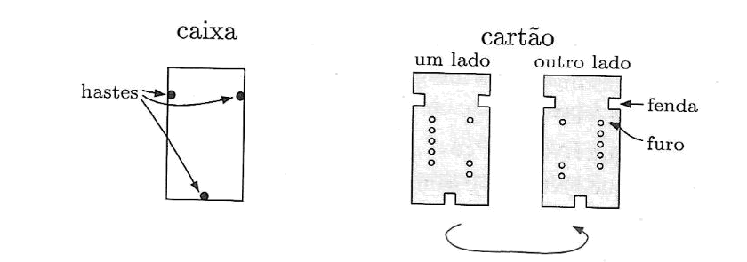
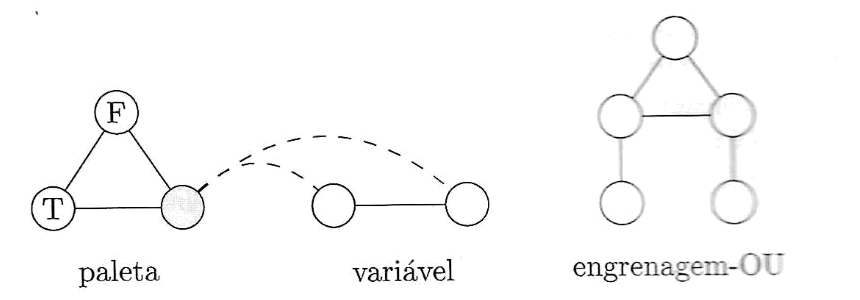

# Capítulo 7 — Complexidade de Tempo: Exercícios e Problemas

Sipser, *Introdução à Teoria da Computação*, edição brasileira, p. 311–318.

## Resumo

| | Quantidade | Números |
|---|---|---|
| **Total** | **49** | Exercícios 7.1–7.11 · Problemas 7.12–7.49 |
| Com solução no livro (R) | 6 | 7.1 (só c, d), 7.2 (só c, d), 7.15, 7.22, 7.31, 7.38 |
| **Sem solução no livro** | **43** | 7.3–7.14, 7.16–7.21, 7.23–7.30, 7.32–7.37, 7.39–7.49 |

Observação: no 7.1 e no 7.2 o livro só responde os itens **c** e **d**. Os itens **a, b, e, f** dos dois ficam sem resposta.

Legenda: ✅ = tem solução em "Soluções selecionadas" (marcado com R no livro) · ⬜ = sem solução · ★ = problema mais difícil (marcado com * no livro).

---

## Exercícios

### ✅ 7.1 *(só os itens c e d)*
Responda VERDADEIRO ou FALSO para cada parte.

- ⬜ **a.** $2n = O(n)$.
- ⬜ **b.** $n^2 = O(n)$.
- ✅ **c.** $n^2 = O(n \log^2 n)$.
- ✅ **d.** $n \log n = O(n^2)$.
- ⬜ **e.** $3^n = 2^{O(n)}$.
- ⬜ **f.** $2^{2^n} = O(2^{2^n})$.

### ✅ 7.2 *(só os itens c e d)*
Responda VERDADEIRO ou FALSO para cada parte.

- ⬜ **a.** $n = o(2n)$.
- ⬜ **b.** $2n = o(n^2)$.
- ✅ **c.** $2^n = o(3^n)$.
- ✅ **d.** $1 = o(n)$.
- ⬜ **e.** $n = o(\log n)$.
- ⬜ **f.** $1 = o(1/n)$.

### ⬜ 7.3
Quais dos seguintes pares de números são primos entre si? Mostre os cálculos que levaram às suas conclusões.

- **a.** 1274 e 10505
- **b.** 7289 e 8029

### ⬜ 7.4
Preencha a tabela descrita no algoritmo de tempo polinomial para reconhecimento de linguagem livre-do-contexto do Teorema 7.16 para a cadeia $w = \texttt{baba}$ e a GLC $G$:

$$
\begin{aligned}
S &\to RT \\
R &\to TR \mid \texttt{a} \\
T &\to TR \mid \texttt{b}
\end{aligned}
$$

### ⬜ 7.5
A fórmula a seguir é satisfazível?

$$
(x \lor y) \land (x \lor \overline{y}) \land (\overline{x} \lor y) \land (\overline{x} \lor \overline{y})
$$

### ⬜ 7.6
Mostre que P é fechada sob união, concatenação e complementação.

### ⬜ 7.7
Mostre que NP é fechada sob união e concatenação.

### ⬜ 7.8
Seja $CONEXO = \{\langle G\rangle \mid G \text{ é um grafo não-direcionado conexo}\}$. Analise o algoritmo dado na página 165 para mostrar que essa linguagem está em P.

### ⬜ 7.9
Um ***triângulo*** em um grafo não-direcionado é um 3-clique. Mostre que $TRIÂNGULO \in \text{P}$, onde $TRIÂNGULO = \{\langle G\rangle \mid G \text{ contém um triângulo}\}$.

### ⬜ 7.10
Mostre que $TODAS_{\text{AFD}}$ está em P.

### ⬜ 7.11
Chame os grafos $G$ e $H$ ***isomorfos*** se os nós de $G$ podem ser reordenados de modo que ele fique idêntico a $H$. Seja $ISO = \{\langle G, H\rangle \mid G \text{ e } H \text{ são grafos isomorfos}\}$. Mostre que $ISO \in \text{NP}$.

---

## Problemas

### ⬜ 7.12
Seja

$$
EXPMOD = \{\langle a, b, c, p\rangle \mid a, b, c \text{ e } p \text{ são inteiros em binário tais que } a^b \equiv c \pmod{p}\}.
$$

Mostre que $EXPMOD \in \text{P}$. (Note que o algoritmo mais óbvio não roda em tempo polinomial. Dica: Tente primeiro com $b$ sendo uma potência de 2.)

### ⬜ 7.13
Uma ***permutação*** sobre o conjunto $\{1, \ldots, k\}$ é uma função bijetora sobre o mesmo. Quando $p$ é uma permutação, $p^t$ denota a composição de $p$ com si mesma $t$ vezes. Seja

$$
POT\text{-}PERM = \{\langle p, q, t\rangle \mid p = q^t \text{ onde } p \text{ e } q \text{ são permutações sobre } \{1, \ldots, k\} \text{ e } t \text{ é um inteiro em binário}\}.
$$

Mostre que $POT\text{-}PERM \in \text{P}$. (Note que o algoritmo mais óbvio não roda em tempo polinomial. Dica: Tente primeiro com $t$ sendo uma potência de 2.)

### ⬜ 7.14
Mostre que P é fechada sob a operação estrela. (Dica: Use programação dinâmica. Sobre uma entrada $y = y_1 \cdots y_n$ for $y_i \in \Sigma$, construa uma tabela que indique, para cada $i \le j$, se a subcadeia $y_i \cdots y_j \in A^*$ para qualquer $A \in \text{P}$.)

### ✅ 7.15
Mostre que NP é fechada sob a operação estrela.

### ⬜ 7.16
Seja $SOMA\text{-}SUBCU$ o problema da soma de subconjuntos no qual todos os números são representados em unário. Por que a prova de NP-completude para $SOMA\text{-}SUBC$ falha em mostrar que $SOMA\text{-}SUBCU$ é NP-completa? Mostre que $SOMA\text{-}SUBCU \in \text{P}$.

### ⬜ 7.17
Mostre que, se P = NP, então toda linguagem $A \in \text{P}$, exceto $A = \emptyset$ e $A = \Sigma^*$, é NP-completa.

### ⬜ ★ 7.18
Mostre que $PRIMOS = \{m \mid m \text{ é um número primo em binário}\} \in \text{NP}$. (Dica: Para $p > 1$ o grupo multiplicativo $Z_p^* = \{x \mid x \text{ e } p \text{ são primos entre si e } 1 \le x < p\}$ é, ambos, cíclico e de ordem $p - 1$ sse $p$ é primo. Você pode usar esse fato sem justificá-lo. A afirmativa mais forte $PRIMOS \in \text{P}$ é atualmente conhecida como verdadeira, mas é mais difícil de provar.)

### ⬜ 7.19
Em geral, acredita-se que $CAM$ não é NP-completa. Explique a razão por trás dessa crença. Mostre que provar que $CAM$ não é NP-completa provaria que P ≠ NP.

### ⬜ 7.20
Suponha que $G$ represente um grafo não-direcionado. Seja também

$$
CAMMÁX = \{\langle G, a, b, k\rangle \mid G \text{ contém um caminho simples de comprimento no máximo } k \text{ de } a \text{ para } b\},
$$

e

$$
CAMMIN = \{\langle G, a, b, k\rangle \mid G \text{ contém um caminho simples de comprimento no mínimo } k \text{ de } a \text{ para } b\}.
$$

- **a.** Mostre que $CAMMÁX \in \text{P}$.
- **b.** Mostre que $CAMMIN$ é NP-completa. Pode assumir a NP-completude de $CAMHAMN$, o problema do caminho hamiltoniano para grafos não-direcionados.

### ⬜ 7.21
Seja $DUPLO\text{-}SAT = \{\langle\phi\rangle \mid \phi \text{ tem pelo menos duas atribuições que a satisfazem}\}$. Mostre que $DUPLO\text{-}SAT$ é NP-completa.

### ✅ 7.22
Seja $MEIO\text{-}CLIQUE = \{\langle G\rangle \mid G \text{ é um grafo não-direcionado que tem um subgrafo completo com pelo menos } m/2 \text{ nós, onde } m \text{ é o número de nós em } G\}$. Mostre que $MEIO\text{-}CLIQUE$ é NP-completa.

### ⬜ 7.23
Seja $FNC_k = \{\langle\phi\rangle \mid \phi \text{ é uma fnc-fórmula satisfazível em que cada variável ocorre em, no máximo, } k \text{ posições}\}$.

- **a.** Mostre que $FNC_2 \in \text{P}$.
- **b.** Mostre que $FNC_3$ é NP-completa.

### ⬜ 7.24
Seja $\phi$ uma 3fnc-fórmula. Uma ***≠-atribuição*** às variáveis de $\phi$ é aquela em que cada cláusula contém dois literais com diferentes valores-verdade. Em outras palavras, uma ≠-atribuição satisfaz $\phi$ sem atribuir verdadeiro a três literais em qualquer cláusula.

- **a.** Mostre que a negação de qualquer ≠-atribuição a $\phi$ é também uma ≠-atribuição.
- **b.** Seja $\ne\!SAT$ a coleção de 3fnc-fórmulas que têm uma ≠-atribuição. Mostre que obtemos uma redução em tempo polinomial de $3SAT$ para $\ne\!SAT$ substituindo cada cláusula $c_i$

  $$(y_1 \lor y_2 \lor y_3)$$

  pelas duas cláusulas

  $$(y_1 \lor y_2 \lor z_i) \quad \text{e} \quad (\overline{z_i} \lor y_3 \lor b),$$

  onde $z_i$ é uma nova variável para cada cláusula $c_i$ e $b$ é uma única variável adicional.
- **c.** Conclua que $\ne\!SAT$ é NP-completa.

### ⬜ 7.25
Um ***corte*** em um grafo não-direcionado é uma separação dos vértices $V$ em dois subconjuntos disjuntos $S$ e $T$. O tamanho de um corte é o número de arestas que têm uma extremidade em $S$ e a outra em $T$. Seja

$$
MÁX\text{-}CORTE = \{\langle G, k\rangle \mid G \text{ tem um corte de tamanho } k \text{ ou mais}\}.
$$

Mostre que $MÁX\text{-}CORTE$ é NP-completa. Você pode assumir o resultado do Problema 7.24. (Dica: Mostre que $\ne\!SAT \le_{\text{P}} MÁX\text{-}CORTE$. A engrenagem da variável $x$ é uma coleção de $3c$ nós rotulados com $x$ e outros $3c$ nós rotulados com $\overline{x}$, onde $c$ é o número de cláusulas. Todos os nós rotulados com $x$ são conectados a todos os nós rotulados com $\overline{x}$. A engrenagem de cláusula é um triângulo de três arestas conectando três nós rotulados com os literais que ocorrem na cláusula. Não use o mesmo nó em mais de uma engrenagem de cláusula. Prove que essa redução funciona.)

### ⬜ 7.26
Você recebe uma caixa e uma coleção de cartões, como ilustrado na figura a seguir. Por causa das hastes na caixa e das fendas nos cartões, cada cartão só poderá ser introduzido na caixa em uma de duas maneiras. Cada cartão contém duas colunas de furos, alguns tapados e outros não. O quebra-cabeças é solucionado colocando-se todos os cartões na caixa de forma a cobrir completamente o fundo da caixa (isto é, cada posição em que há um furo é bloqueada por pelo menos um cartão que não tem furo naquela posição). Seja $CHARADA = \{\langle c_1, \ldots, c_k\rangle \mid \text{cada } c_i \text{ representa um cartão e essa coleção de cartões tem uma solução}\}$. Mostre que $CHARADA$ é NP-completa.

*Figura da p. 314: à esquerda, a caixa com as hastes. À direita, um cartão visto de um lado e do outro (a seta indica que ele pode ser virado), com as fendas e os furos.*

### ⬜ 7.27
Uma ***coloração*** de um grafo é uma atribuição de cores a seus nós de forma que não seja atribuída a mesma cor a nenhum par de nós adjacentes. Seja

$$
3CORES = \{\langle G\rangle \mid \text{os nós de } G \text{ podem ser coloridos com três cores de forma que nenhum par de nós unidos por uma aresta tenha a mesma cor}\}.
$$

Mostre que $3CORES$ é NP-completa. (Dica: Use os três grafos a seguir.)

*Figura da p. 315: a **paleta** (triângulo com os nós T, F e um terceiro nó sombreado), a **variável** (dois nós ligados entre si e, pelas linhas tracejadas, ao nó sombreado da paleta) e a **engrenagem-OU**.*

### ⬜ 7.28
Seja $CONJ\text{-}PART = \{\langle S, C\rangle \mid S \text{ é um conjunto finito e } C = \{C_1, \ldots, C_k\} \text{ é uma coleção de subconjuntos de } S, \text{ para algum } k > 0, \text{ tal que os elementos de } S \text{ podem ser coloridos } \textit{vermelho} \text{ ou } \textit{azul} \text{ de forma que nenhum } C_i \text{ tenha todos os seus elementos coloridos com a mesma cor}\}$. Mostre que $CONJ\text{-}PART$ é NP-completa.

### ⬜ 7.29
Considere o seguinte problema de escalonamento. É dada uma lista de exames finais $F_1, \ldots, F_k$, a serem escalonados, e uma lista de estudantes $S_1, \ldots, S_l$. Cada estudante deve fazer um certo subconjunto desses exames. Você deve escalonar os exames em períodos, de maneira que a nenhum estudante seja requerido fazer dois deles no mesmo período. O problema é determinar se existe um escalonamento que utilize apenas $h$ períodos. Formule este problema como uma linguagem e mostre que a mesma é NP-completa.

### ⬜ 7.30
Este problema é inspirado no jogo de um único jogador *campo minado*, generalizado para um grafo arbitrário. Seja $G$ um grafo não-direcionado em que cada nó contém uma única *mina* ou está vazio. O jogador escolhe nós, um a um. Se ele escolher um nó que contém uma mina, ele perde. Se escolher um nó vazio, o jogador descobre o número de nós vizinhos que contêm minas. (Um nó vizinho é aquele que está conectado ao nó escolhido por uma aresta.) O jogador vence se e quando todos os nós vazios tiverem sido escolhidos.

No *problema da consistência das minas* é dado um grafo $G$, juntamente com números rotulando alguns nós de $G$. Deve-se determinar se é possível uma colocação de minas nos nós restantes, de forma que qualquer nó $v$ que receba o rótulo $m$ tenha exatamente $m$ nós vizinhos contendo minas. Formule este problema como uma linguagem e mostre que ele é NP-completo.

### ✅ 7.31
No seguinte jogo de paciência, é dado um tabuleiro $n \times n$. Em cada uma das suas $n^2$ posições está colocada uma pedra, azul ou vermelha, ou nenhuma pedra. Você joga removendo pedras do tabuleiro até que cada coluna contenha apenas pedras de uma única cor e cada linha contenha pelo menos uma pedra. Você vence se atingir esse objetivo. Vencer pode ser possível ou não, dependendo da configuração inicial. Seja $PACIÊNCIA = \{\langle G\rangle \mid G \text{ é uma configuração de vitória possível}\}$. Prove que $PACIÊNCIA$ é NP-completa.

### ⬜ 7.32
Seja $U = \{\langle M, x, \#^t\rangle \mid \text{a MT } M \text{ aceita a entrada } x, \text{ em no máximo } t \text{ passos, sobre pelo menos um ramo}\}$. Mostre que $U$ is NP-completa.

### ⬜ 7.33
Lembre-se que, em nossa discussão da tese de Church-Turing, introduzimos a linguagem $D = \{\langle p\rangle \mid p \text{ é um polinômio sobre várias variáveis com uma raiz inteira}\}$. Afirmamos, mas não provamos, que $D$ é indecidível. Nesse problema, pede-se que você prove uma propriedade diferente de $D$ — qual seja, que $D$ é NP-difícil. Um problema é ***NP-difícil*** se todos os problemas em NP são redutíveis a ele em tempo polinomial, mesmo que ele próprio possa não estar em NP. Logo, você deve mostrar que todos os problemas em NP são redutíveis a $D$ em tempo polinomial.

### ⬜ 7.34
Um subconjunto dos nós de um grafo $G$ é um ***conjunto dominante*** se todo outro nó de $G$ é adjacente a algum nó do subconjunto. Seja

$$
CONJ\text{-}DOM = \{\langle G, k\rangle \mid G \text{ tem um conjunto dominante com } k \text{ nós}\}.
$$

Mostre que ela é NP-completa fazendo uma redução a partir de $COB\text{-}VERT$.

### ⬜ ★ 7.35
Mostre que o seguinte problema é NP-completo. É dado um conjunto de estados $Q = \{q_0, q_1, \ldots, q_l\}$ e uma coleção de pares $\{(s_1, r_1), \ldots, (s_k, r_k)\}$ em que $s_i$ são cadeias distintas sobre $\Sigma = \{0, 1\}$, e os $r_i$ são membros (não necessariamente distintos) de $Q$. Determine se existe um AFD $M = (Q, \Sigma, \delta, q_0, F)$ em que $\delta(q_0, s_i) = r_i$ para cada $i$. Aqui, $\delta(q, s)$ é o estado que $M$ atinge após ler $s$, começando no estado $q$. (Note que $F$ é irrelevante aqui).

### ⬜ ★ 7.36
Mostre que se P = NP, existe um algoritmo de tempo polinomial que produz uma atribuição que satisfaz uma fórmula booleana dada quando a mesma for satisfazível. (Nota: O algoritmo pedido computa uma função, mas NP contém linguagens, não funções. A suposição P = NP implica que $SAT$ está em P e, assim, testar por satisfazibilidade é solúvel em tempo polinomial. Mas a suposição não diz como esse teste é feito, e o teste pode não revelar atribuições que satisfazem as fórmulas. Você deve mostrar que pode encontrá-las de alguma forma. Dica: Use o testador de satisfazibilidade repetidamente para encontrar a atribuição bit-por-bit.)

### ⬜ ★ 7.37
Mostre que se P = NP, você consegue fatorar inteiros em tempo polinomial. (Veja a nota no Problema 7.36.)

### ✅ ★ 7.38
Mostre que se P = NP, existe um algoritmo de tempo polinomial que recebe um grafo não-direcionado como entrada e encontra um maior clique contido no grafo. (Veja a nota no Problema 7.36.)

### ⬜ 7.39
Na prova do teorema de Cook-Levin, uma janela é um retângulo $2 \times 3$ de células. Mostre porque a prova falharia se, em vez disso, tivéssemos usado janelas $2 \times 2$.

### ⬜ ★ 7.40
Considere o algoritmo $MINIMIZA$, que recebe um AFD $M$ como entrada e dá como saída um AFD $M'$.

$MINIMIZA$ = "Sobre a entrada $\langle M\rangle$, onde $M = (Q, \Sigma, \delta, q_0, A)$ é um AFD:

1. Remova todos os estados de $M$ que são inalcançáveis a partir do estado inicial.
2. Construa o seguinte grafo não-direcionado $G$ cujos nós são os estados de $M$.
3. Coloque uma aresta em $G$ conectando todo estado de aceitação com todo estado de não-aceitação. Adicione novas arestas como segue.
4. Repita até que nenhuma nova aresta seja adicionada $G$:
5. &nbsp;&nbsp;&nbsp;&nbsp;Para cada par de estados distintos $q$ e $r$ de $M$ e todo $a \in \Sigma$:
6. &nbsp;&nbsp;&nbsp;&nbsp;&nbsp;&nbsp;&nbsp;&nbsp;Adicione a aresta $(q, r)$ a $G$ se $(\delta(q, a), \delta(r, a))$ for uma aresta de $G$.
7. Para cada estado $q$, seja $[q]$ a coleção de estados $[q] = \{r \in Q \mid \text{nenhuma aresta une } q \text{ e } r \text{ em } G\}$.
8. Forme um novo AFD $M' = (Q', \Sigma, \delta', q_0', A')$ em que
   - $Q' = \{[q] \mid q \in Q\}$, (se $[q] = [r]$, apenas um deles está em $Q'$),
   - $\delta'([q], a) = [\delta(q, a)]$, para todo $q \in Q$ e $a \in \Sigma$,
   - $q_0' = [q_0]$, e
   - $A' = \{[q] \mid q \in A\}$.
9. Dê como saída $\langle M'\rangle$."

- **a.** Mostre que $M$ e $M'$ são equivalentes.
- **b.** Mostre que $M'$ é mínimo — isto é, nenhum AFD com menos estados reconhece a mesma linguagem. Você pode utilizar o resultado do Problema 1.52 sem prova.
- **c.** Mostre que $MINIMIZA$ opera em tempo polinomial.

### ⬜ 7.41
Para uma fnc-fórmula $\phi$ com $m$ variáveis e $c$ cláusulas, mostre que pode construir, em tempo polinomial, um AFN com $O(cm)$ estados que aceita todas as atribuições que não satisfazem $\phi$ representadas como cadeias booleanas de comprimento $m$. Conclua que AFNs não podem ser minimizados em tempo polinomial, a menos que P = NP.

### ⬜ ★ 7.42
Uma ***2fnc-fórmula*** é um E de cláusulas em que cada uma é um OU de no máximo dois literais. Seja $2SAT = \{\langle\phi\rangle \mid \phi \text{ é uma 2fnc-fórmula satisfazível}\}$. Mostre que $2SAT \in \text{P}$.

### ⬜ 7.43
Modifique o algoritmo para reconhecimento de linguagens livres-do-contexto da prova do Teorema 7.16 para dar um algoritmo de tempo polinomial que produza uma árvore sintática para uma cadeia, dadas uma cadeia e uma GLC, se a gramática gerar a cadeia.

### ⬜ 7.44
Digamos que duas fórmulas booleanas são ***equivalentes*** se têm o mesmo conjunto de variáveis e são verdadeiras para o mesmo conjunto de atribuições às variáveis (isto é, elas descrevem a mesma função booleana). Uma fórmula booleana é ***mínima*** se nenhuma fórmula booleana menor é equivalente a ela. Seja $FÓRMULA\text{-}MÍN$ a coleção de fórmulas booleanas mínimas. Mostre que, se P = NP, então $FÓRMULA\text{-}MÍN \in \text{P}$.

### ⬜ 7.45
A ***hierarquia de diferenças*** $\text{D}_i\text{P}$ é definida recursivamente como

- **a.** $\text{D}_1\text{P} = \text{NP}$ e
- **b.** $\text{D}_i\text{P} = \{A \mid A = B \setminus C \text{ para } B \text{ em NP e } C \text{ em } \text{D}_{i-1}\text{P}\}$. (Aqui, $B \setminus C = B \cap \overline{C}$.)

Por exemplo, uma linguagem em $\text{D}_2\text{P}$ é a diferença entre duas linguagens NP. Algumas vezes, $\text{D}_2\text{P}$ é denominada DP (e pode ser escrita $\text{D}^{\text{P}}$). Seja

$$
Z = \{\langle G_1, k_1, G_2, k_2\rangle \mid G_1 \text{ tem um } k_1\text{-clique e } G_2 \text{ não tem um } k_2\text{-clique}\}.
$$

Mostre que $Z$ é completa para DP. Em outras palavras, mostre que toda linguagem em DP é redutível em tempo polinomial a $Z$.

### ⬜ ★ 7.46
Seja $MÁX\text{-}CLIQUE = \{\langle G, k\rangle \mid \text{o maior clique em } G \text{ é de tamanho } k\}$. Use o resultado do Problema 7.45 para mostrar que $MÁX\text{-}CLIQUE$ é DP-completa.

### ⬜ ★ 7.47
Seja $f: \mathcal{N} \to \mathcal{N}$ qualquer função tal que $f(n) = o(n \log n)$. Mostre que $\text{TIME}(f(n))$ contém apenas as linguagens regulares.

### ⬜ ★ 7.48
Chame uma expressão regular ***livre-de-estrela*** se ela não contém quaisquer operações estrela. Seja $EQ_{\text{ER-LE}} = \{\langle R, S\rangle \mid R \text{ e } S \text{ são expressões regulares livres-de-estrela equivalentes}\}$. Mostre que $EQ_{\text{ER-LE}}$ está em coNP. Por que o seu argumento falha para expressões regulares em geral?

### ⬜ ★ 7.49
Este problema investiga ***resolução***, um método para provar a insatisfazibilidade de fnc-fórmulas. Seja $\phi = C_1 \land C_2 \land \cdots \land C_m$ uma fórmula em fnc, onde os $C_i$ são suas cláusulas. Seja $\mathcal{C} = \{C_i \mid C_i \text{ é uma cláusula de } \phi\}$. Em um *passo de resolução*, tomamos duas cláusulas $C_a$ e $C_b$ de $\mathcal{C}$ que tenham uma variável $x$ em comum, que ocorre positivamente em uma delas e negativamente na outra. Assim, $C_a = (x \lor y_1 \lor y_2 \lor \cdots \lor y_k)$ e $C_b = (\overline{x} \lor z_1 \lor z_2 \lor \cdots \lor z_l)$, onde os $y_i$ e $z_i$ são literais. Formamos a nova cláusula $(y_1 \lor y_2 \lor \cdots \lor y_k \lor z_1 \lor z_2 \lor \cdots \lor z_l)$ e removemos literais repetidos. Acrescente essa nova cláusula a $\mathcal{C}$. Repita os passos de resolução até que não possam ser obtidas cláusulas adicionais. Se a cláusula vazia ( ) está em $\mathcal{C}$, então declare $\phi$ insatisfazível.

Digamos que resolução é ***correta*** se nunca declara uma fórmula satisfazível como sendo insatisfazível. E digamos que resolução é ***completa*** se todas as fórmulas insatisfazíveis são declaradas como sendo insatisfazíveis.

- **a.** Mostre que resolução é correta e completa.
- **b.** Use a parte (a) para mostrar que $2SAT \in \text{P}$.
